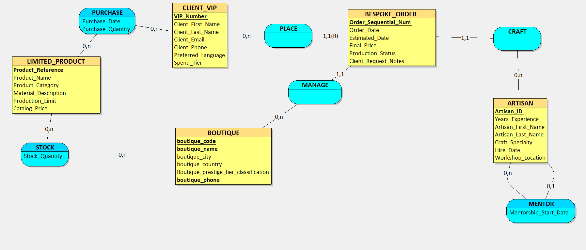
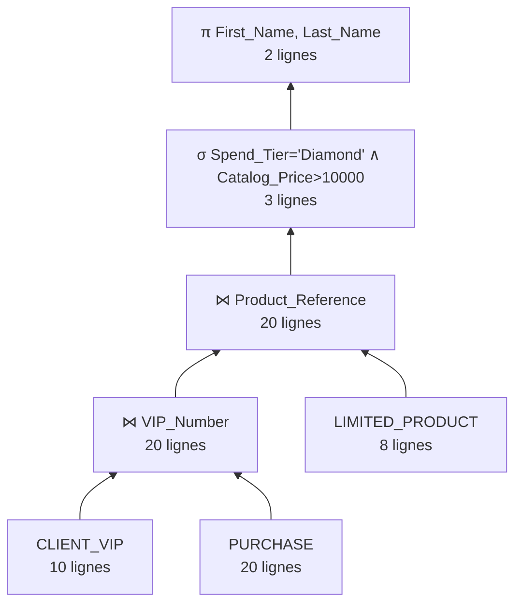
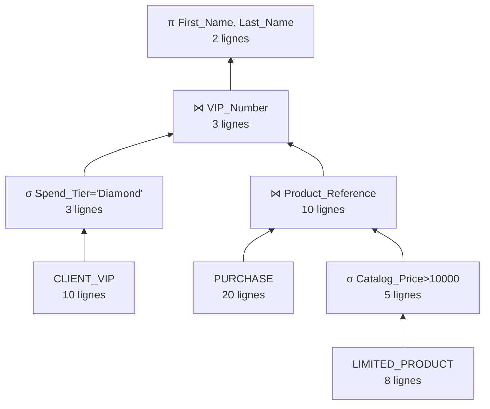
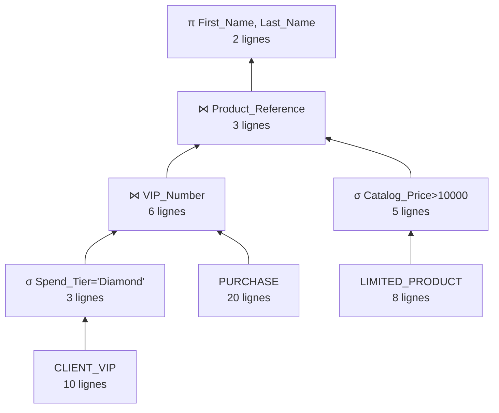

# Mini-projet TI503N – Base de données d'une maison de haute couture

**Binôme :** Abdelkader AISSA BENHADDAD – Samy AOUCHICHE
**Domaine :** mode de luxe et haute couture (comme Louis Vuitton, Hermès, Dior)

# Partie 1

## 1. Étape 1 : Analyse des besoins

### 1.1 Prompt utilisé

Fichier : `prompts/prompt_etape1_fr.txt`

```text
Tu travailles dans le domaine de la mode de luxe et de la haute couture. Ton entreprise a comme activité de concevoir, fabriquer et vendre de la maroquinerie haut de gamme, de la joaillerie sur mesure et des collections exclusives de prêt-à-porter. C'est une entreprise comme Louis Vuitton, Hermès ou Dior. Nous avons collecté des données concernant : nos boutiques internationales, nos artisans hautement qualifiés (y compris les relations de mentorat entre artisans maîtres et artisans juniors), les profils de notre clientèle VIP, les commandes sur mesure complexes (qui impliquent toujours un client précis, une boutique dédiée et un artisan assigné) et les éditions limitées de nos produits. Inspire-toi du site web suivant : la présentation du groupe LVMH (https://www.lvmh.com/group/), ainsi que des connaissances générales sur les services sur mesure et le savoir-faire artisanal d'Hermès.
Ton entreprise veut appliquer MERISE pour concevoir un système d'information. Tu es chargé de la partie analyse, c'est-à-dire de collecter les besoins auprès de l'entreprise. Elle a fait appel à un étudiant en ingénierie informatique pour réaliser ce projet, tu dois lui fournir les informations nécessaires pour qu'il applique ensuite lui-même les étapes suivantes de conception et développement de la base de données.
D'abord, établis les règles de gestion des données de ton entreprise, sous la forme d'une liste à puces. Elle doit correspondre aux informations que fournit quelqu'un qui connaît le fonctionnement de l'entreprise, mais pas comment se construit un système d'information.
Ensuite, à partir de ces règles, fournis un dictionnaire de données brutes avec les colonnes suivantes, regroupées dans un tableau : signification de la donnée, type, taille en nombre de caractères ou de chiffres. Il doit y avoir entre 25 et 35 données. Il sert à fournir des informations supplémentaires sur chaque donnée (taille et type) mais sans a priori sur comment les données vont être modélisées ensuite.
Fournis donc les règles de gestion et le dictionnaire de données.
```

### 1.2 Règles de gestion obtenues

**Nos boutiques et notre réseau**

- Nous exploitons un réseau de boutiques internationales. Chaque boutique est identifiée par un code unique, un nom et sa localisation (ville et pays).
- Chaque boutique a un niveau de prestige précis (par exemple : Flagship, Pop-up, Historique) et un numéro de téléphone principal.

**Nos artisans et la transmission (relation récursive)**

- Chaque artisan est identifié par un identifiant employé unique. Nous enregistrons son prénom, son nom, sa spécialité artisanale (par exemple : maroquinerie, sertissage) et sa date d'embauche.
- La transmission du savoir-faire est essentielle : un artisan « Junior » doit être encadré par un artisan « Maître ».
- Un « Maître » peut encadrer plusieurs juniors, mais un junior n'a qu'un seul mentor actif à la fois. Cela constitue une hiérarchie interne stricte.

**Notre clientèle VIP (entité forte)**

- Nos clients sont des membres exclusifs identifiés par un numéro d'adhésion VIP unique.
- Nous conservons leurs informations personnelles (prénom, nom), leurs coordonnées (e-mail, téléphone), leur langue préférée et leur niveau de dépenses cumulées (par exemple : Platine, Diamant).

**Les commandes sur mesure (entité faible)**

- Le « sur mesure » est notre service ultra-personnalisé. Pour préserver la confidentialité et l'exclusivité des clients, nous n'utilisons pas de numéro de commande global.
- Règle spécifique : une commande sur mesure est identifiée par un numéro séquentiel propre au dossier du client (par exemple : 1ʳᵉ commande du client X, 2ᵉ commande du client X). Une commande ne peut donc pas exister sans être rattachée à un client VIP.
- Chaque commande a une date de création, une date de livraison estimée, un prix final négocié et un statut de production.
- Une commande est toujours gérée par exactement une boutique et réalisée par exactement un artisan principal.

**Les produits en édition limitée**

- Nous créons des produits rares (sacs à main, montres) identifiés par une référence unique.
- Chaque produit a un nom, une catégorie, une description de matière, un prix catalogue et une limite de production stricte (par exemple : 50 pièces maximum dans le monde).

### 1.3 Dictionnaire de données obtenu

| Signification de la donnée | Type | Taille (caractères / chiffres) |
|---|---|---|
| **BOUTIQUE** | | |
| Code unique de la boutique (`boutique_code`) | Alphanumérique | 10 |
| Nom de la boutique (`boutique_name`) | Alphanumérique | 50 |
| Ville de la boutique (`boutique_city`) | Alphanumérique | 50 |
| Pays de la boutique (`boutique_country`) | Alphanumérique | 50 |
| Niveau de prestige de la boutique (`Boutique_prestige_tier_classification`) | Alphanumérique | 20 |
| Numéro de téléphone de la boutique (`boutique_phone`) | Alphanumérique | 20 |
| **ARTISAN** | | |
| Identifiant employé de l'artisan (`Artisan_ID`) | Alphanumérique | 10 |
| Prénom de l'artisan (`Artisan_First_Name`) | Alphanumérique | 50 |
| Nom de l'artisan (`Artisan_Last_Name`) | Alphanumérique | 50 |
| Spécialité artisanale (`Craft_Specialty`) | Alphanumérique | 40 |
| Date d'embauche (`Hire_Date`) | Date | 10 |
| Date de début du mentorat (`Mentorship_Start_Date`) | Date | 10 |
| **CLIENT_VIP** | | |
| Numéro d'adhésion VIP (`VIP_Number`) | Alphanumérique | 15 |
| Prénom du client (`Client_First_Name`) | Alphanumérique | 50 |
| Nom du client (`Client_Last_Name`) | Alphanumérique | 50 |
| Adresse e-mail du client (`Client_Email`) | Alphanumérique | 100 |
| Numéro de téléphone du client (`Client_Phone`) | Alphanumérique | 20 |
| Langue préférée (`Preferred_Language`) | Alphanumérique | 20 |
| Niveau de dépenses cumulées (`Spend_Tier`) | Alphanumérique | 30 |
| **LIMITED_PRODUCT** | | |
| Référence du produit (`Product_Reference`) | Alphanumérique | 15 |
| Nom du produit (`Product_Name`) | Alphanumérique | 100 |
| Catégorie du produit (`Product_Category`) | Alphanumérique | 30 |
| Description de la matière principale (`Material_Description`) | Alphanumérique | 200 |
| Limite de production, quantité max (`Production_Limit`) | Numérique | 4 |
| Prix catalogue en euros (`Catalog_Price`) | Numérique | 8 |
| **BESPOKE_ORDER** | | |
| Numéro séquentiel de la commande : 01, 02… (`Order_Sequential_Num`) | Numérique | 3 |
| Date de création de la commande (`Order_Date`) | Date | 10 |
| Date de livraison estimée (`Estimated_Date`) | Date | 10 |
| Prix final négocié (`Final_Price`) | Numérique | 9 |
| Statut de production (`Production_Status`) | Alphanumérique | 30 |
| Description de la demande spéciale (`Client_Request_Notes`) | Alphanumérique | 500 |

Total : 31 données.

## 2. Étape 2 : MCD



Fichier source : `MCD_AISSA-BENHADDAD_AOUCHICHE.loo`

**Entités :** `BOUTIQUE`, `ARTISAN`, `CLIENT_VIP`, `LIMITED_PRODUCT`, `BESPOKE_ORDER`
**Associations :** `PLACE`, `MANAGE`, `CRAFT`, `MENTOR`, `STOCK`, `PURCHASE`

**Éléments de modélisation avancée :**

- **Association récursive :** `MENTOR` sur `ARTISAN`. Un junior a au plus un mentor (0,1), un master peut en encadrer plusieurs (0,n). `Mentorship_Start_Date` est portée par l'association.
- **Entité faible :** `BESPOKE_ORDER`, identifiée par `Order_Sequential_Num` relativement à `CLIENT_VIP` via l'association `PLACE` (1,1)(R).
- **Entité forte :** `CLIENT_VIP`, identifiée par `VIP_Number`.

**Données ajoutées au dictionnaire :** `Years_Experience` et `Workshop_Location` (dans `ARTISAN`), `Stock_Quantity` (dans `STOCK`), `Purchase_Date` et `Purchase_Quantity` (dans `PURCHASE`).

---

# Partie 2

## 3. Étape 3 : MLD et MPD

### 3.1 MLD

```text
BOUTIQUE = (Boutique_Code VARCHAR(10), Boutique_Name VARCHAR(50), Boutique_City VARCHAR(50), Boutique_Country VARCHAR(50), Prestige_Tier VARCHAR(20), Boutique_Phone VARCHAR(20));
ARTISAN = (Artisan_ID VARCHAR(10), First_Name VARCHAR(50), Last_Name VARCHAR(50), Craft_Specialty VARCHAR(40), Hire_Date DATE, Years_Experience INT, Workshop_Location VARCHAR(50), #Mentor_ID, Mentorship_Start_Date DATE);
CLIENT_VIP = (VIP_Number VARCHAR(15), First_Name VARCHAR(50), Last_Name VARCHAR(50), Email VARCHAR(100), Phone VARCHAR(20), Preferred_Language VARCHAR(20), Spend_Tier VARCHAR(30));
LIMITED_PRODUCT = (Product_Reference VARCHAR(15), Product_Name VARCHAR(100), Product_Category VARCHAR(30), Material_Description VARCHAR(200), Production_Limit INT, Catalog_Price DECIMAL(10,2));
BESPOKE_ORDER = (#VIP_Number, Order_Sequential_Num INT, Order_Date DATE, Estimated_Date DATE, Final_Price DECIMAL(11,2), Production_Status VARCHAR(30), Client_Request_Notes VARCHAR(500), #Artisan_ID, #Boutique_Code);
STOCK = (#Boutique_Code, #Product_Reference, Stock_Quantity INT);
PURCHASE = (#VIP_Number, #Product_Reference, Purchase_Date DATE, Purchase_Quantity INT);
```

Clés primaires : `Boutique_Code`, `Artisan_ID`, `VIP_Number`, `Product_Reference`, (`VIP_Number`, `Order_Sequential_Num`), (`Boutique_Code`, `Product_Reference`), (`VIP_Number`, `Product_Reference`, `Purchase_Date`).

L'association récursive `MENTOR` (0,1 – 0,n) ne crée pas de table : `ARTISAN` reçoit la clé étrangère `Mentor_ID` et l'attribut `Mentorship_Start_Date`.

### 3.2 MPD

- `1_creation.sql` : création des tables avec les clés primaires et étrangères.
- `2_contraintes.sql` : contraintes de validation.

## 4. Étape 4 : Insertion des données

Prompt (fichier `prompts/prompt_insertion.txt`), résultat dans `3_insertion.sql` :

```text
Fournis les requêtes d'insertion permettant de remplir la base de données, dont le modèle relationnel est le suivant :

BOUTIQUE(Boutique_Code, Boutique_Name, Boutique_City, Boutique_Country, Prestige_Tier, Boutique_Phone) Clé primaire : Boutique_Code
ARTISAN(Artisan_ID, First_Name, Last_Name, Craft_Specialty, Hire_Date, Years_Experience, Workshop_Location, #Mentor_ID, Mentorship_Start_Date) Clé primaire : Artisan_ID
CLIENT_VIP(VIP_Number, First_Name, Last_Name, Email, Phone, Preferred_Language, Spend_Tier) Clé primaire : VIP_Number
LIMITED_PRODUCT(Product_Reference, Product_Name, Product_Category, Material_Description, Production_Limit, Catalog_Price) Clé primaire : Product_Reference
BESPOKE_ORDER(#VIP_Number, Order_Sequential_Num, Order_Date, Estimated_Date, Final_Price, Production_Status, Client_Request_Notes, #Artisan_ID, #Boutique_Code) Clé primaire : VIP_Number, Order_Sequential_Num
STOCK(#Boutique_Code, #Product_Reference, Stock_Quantity) Clé primaire : Boutique_Code, Product_Reference
PURCHASE(#VIP_Number, #Product_Reference, Purchase_Date, Purchase_Quantity) Clé primaire : VIP_Number, Product_Reference, Purchase_Date

Les clés primaires correspondent aux identifiants, sauf indication contraire (lorsqu'il s'agit d'un attribut composé).
Les clés étrangères sont identifiées par # et portent le même nom que les clés primaires auxquelles elles font référence.

Il doit y avoir : 5 lignes pour BOUTIQUE, 8 lignes pour ARTISAN (dont au moins 3 maîtres ayant NULL pour Mentor_ID, et 5 juniors qui font référence à ces maîtres), 10 lignes pour CLIENT_VIP, 8 lignes pour LIMITED_PRODUCT, 15 lignes pour BESPOKE_ORDER, 15 lignes pour STOCK et 20 lignes pour PURCHASE.

Les données doivent correspondre à une maison de mode de luxe et de haute couture (comme Louis Vuitton ou Hermès), avec des boutiques internationales, des matières d'exception et des clients très fortunés d'origines internationales variées.

Les clés étrangères doivent faire référence à des clés primaires existantes : fournis les lignes en commençant par remplir les tables qui n'ont pas de clé étrangère, puis les tables dont les clés étrangères font référence à des clés primaires de tables déjà remplies. Pour la table récursive ARTISAN, insère les maîtres avant les juniors.

Les données doivent respecter les contraintes de validation suivantes :
ALTER TABLE ARTISAN ADD CONSTRAINT chk_mentorship_date CHECK (Mentorship_Start_Date >= Hire_Date);
ALTER TABLE BESPOKE_ORDER ADD CONSTRAINT chk_order_dates CHECK (Estimated_Date >= Order_Date);
ALTER TABLE LIMITED_PRODUCT ADD CONSTRAINT chk_positive_price CHECK (Catalog_Price > 0);
ALTER TABLE LIMITED_PRODUCT ADD CONSTRAINT chk_positive_limit CHECK (Production_Limit > 0);
ALTER TABLE STOCK ADD CONSTRAINT chk_positive_stock CHECK (Stock_Quantity >= 0);
ALTER TABLE PURCHASE ADD CONSTRAINT chk_positive_purchase CHECK (Purchase_Quantity > 0);
ALTER TABLE BESPOKE_ORDER ADD CONSTRAINT chk_positive_bespoke_price CHECK (Final_Price >= 0);

Fournis l'ensemble sous la forme d'un script SQL prêt à être exécuté.
```

## 5. Étape 5 : Interrogation de la base

### 5.1 Scénario d'utilisation

La base est utilisée par la directrice marketing internationale de la maison et par l'équipe de gestion de la relation client (CRM). La maison prépare un défilé ultra-exclusif à Paris et doit établir la liste des invités. L'équipe marketing analyse le comportement d'achat des clients VIP, en ciblant en priorité les clients Diamond, nos plus gros acheteurs. Comme notre clientèle est internationale, elle extrait aussi la langue préférée de chaque client pour envoyer des invitations personnalisées dans sa langue. Au-delà de l'événement, l'équipe suit la popularité de nos éditions limitées et les niveaux de stock dans nos boutiques internationales : si un client VIP veut acquérir une pièce vue sur le podium, l'équipe sait immédiatement quelle boutique peut la lui fournir.

**Données à extraire :**

- les clients et leur langue préférée, pour les invitations ;
- les clients Diamond ayant acheté des pièces de grande valeur ;
- l'historique d'achats des clients et le volume acheté par niveau de client ;
- les commandes sur mesure (statut, prix, chiffre d'affaires par boutique) ;
- les produits en édition limitée (prix, matières, catégories) ;
- le stock des boutiques, pour savoir où trouver une pièce.

Les requêtes correspondantes sont dans `4_interrogation.sql`.

### 5.2 Étude des plans d'exécution

**Requête étudiée** : les clients Diamond ayant acheté un produit à plus de 10 000 € (invités prioritaires du défilé).

```sql
SELECT First_Name, Last_Name
FROM CLIENT_VIP
WHERE Spend_Tier = 'Diamond'
AND VIP_Number IN (
    SELECT pu.VIP_Number
    FROM PURCHASE pu
    INNER JOIN LIMITED_PRODUCT p ON pu.Product_Reference = p.Product_Reference
    WHERE p.Catalog_Price > 10000
);
```

En algèbre relationnelle, elle utilise trois opérateurs différents : la sélection σ, la jointure ⋈ et la projection π.

π<sub>First_Name, Last_Name</sub> ( σ<sub>Spend_Tier='Diamond'</sub>(CLIENT_VIP) ⋈ PURCHASE ⋈ σ<sub>Catalog_Price>10000</sub>(LIMITED_PRODUCT) )

**Tailles des relations :** `CLIENT_VIP` = 10 lignes, `PURCHASE` = 20 lignes, `LIMITED_PRODUCT` = 8 lignes.

**Modèle de coût (comme dans l'exercice 6 du TD3) :**
- une sélection sur une relation de *n* lignes coûte *n* instructions (une comparaison par ligne) ;
- une jointure par boucles imbriquées entre *n* et *m* lignes coûte *n* × *m* instructions ;
- une projection sur *n* lignes coûte *n* instructions.

#### Plan 1 : jointures d'abord, sélections à la fin



| Étape | Calcul | Instructions | Lignes obtenues |
|---|---|---|---|
| CLIENT_VIP ⋈ PURCHASE | 10 × 20 | 200 | 20 |
| ⋈ LIMITED_PRODUCT | 20 × 8 | 160 | 20 |
| σ (Diamond et prix > 10 000) | 20 | 20 | 3 |
| π | 3 | 3 | 2 |
| **Total** | | **383** | |

#### Plan 2 : sélections d'abord, puis PURCHASE ⋈ produits filtrés



| Étape | Calcul | Instructions | Lignes obtenues |
|---|---|---|---|
| σ Catalog_Price > 10000 | 8 | 8 | 5 |
| σ Spend_Tier = 'Diamond' | 10 | 10 | 3 |
| PURCHASE ⋈ produits filtrés | 20 × 5 | 100 | 10 |
| clients filtrés ⋈ résultat | 3 × 10 | 30 | 3 |
| π | 3 | 3 | 2 |
| **Total** | | **151** | |

#### Plan 3 : sélections d'abord, puis clients filtrés ⋈ PURCHASE



| Étape | Calcul | Instructions | Lignes obtenues |
|---|---|---|---|
| σ Spend_Tier = 'Diamond' | 10 | 10 | 3 |
| σ Catalog_Price > 10000 | 8 | 8 | 5 |
| clients filtrés ⋈ PURCHASE | 3 × 20 | 60 | 6 |
| ⋈ produits filtrés | 6 × 5 | 30 | 3 |
| π | 3 | 3 | 2 |
| **Total** | | **111** | |

#### Conclusion

| Plan | Instructions |
|---|---|
| Plan 1 (jointures d'abord) | 383 |
| Plan 2 (sélections d'abord, PURCHASE ⋈ produits) | 151 |
| Plan 3 (sélections d'abord, clients ⋈ PURCHASE) | **111** |

Le **plan 3** est le plan optimisé. Deux règles expliquent ce résultat :
1. **Descendre les sélections au plus près des tables** réduit la taille des relations avant les jointures, qui sont les opérations les plus coûteuses : on passe de 383 à 151 instructions.
2. **Commencer les jointures par la relation la plus petite après sélection** (3 clients Diamond plutôt que 5 produits) limite encore les résultats intermédiaires : 6 lignes au lieu de 10, et 111 instructions au total.

Le résultat final est le même pour les trois plans : 3 achats correspondent, soit 2 clientes distinctes après projection, Camille Fontaine et Mei Lin.

## 6. Organisation du dépôt

```text
.
├── README.md
├── MCD.png                              # image du MCD
├── MCD_AISSA-BENHADDAD_AOUCHICHE.loo    # source du MCD (Looping)
├── 1_creation.sql                       # MPD : tables et contraintes d'intégrité
├── 2_contraintes.sql                    # contraintes de validation
├── 3_insertion.sql                      # données générées par IA
├── 4_interrogation.sql                  # 20 requêtes du scénario
└── prompts/
    ├── prompt_etape1_fr.txt             # prompt de l'analyse des besoins
    └── prompt_insertion.txt             # prompt de génération des données
```
